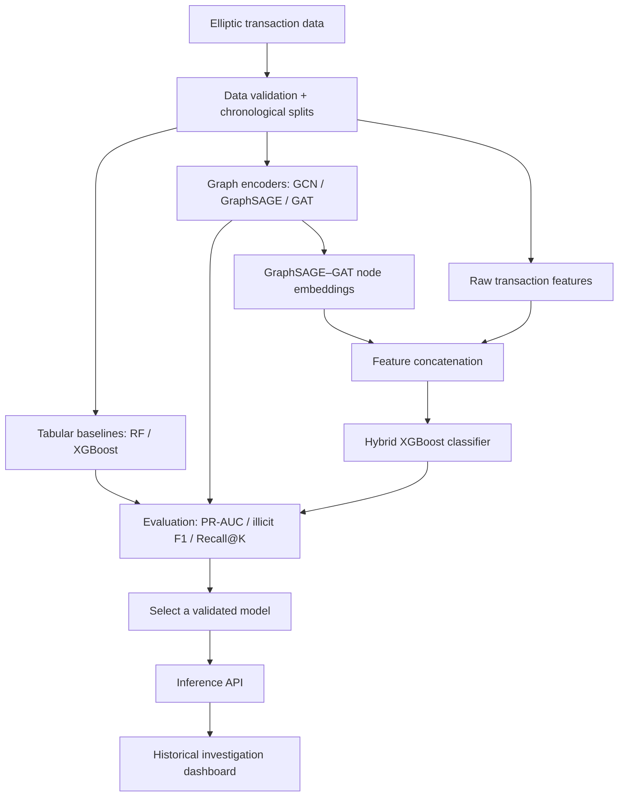

# CryptoGuard++

**Research-to-product platform for explainable illicit Bitcoin transaction risk detection.**

> **Status:** Week 1 — Graph ML foundations. This repository is an **early-stage research and engineering project**, not a finished AML system. The only implemented learning artifact in the starter repository is the Week 1 GCN notebook; later components are roadmap items.

CryptoGuard++ explores whether graph representations and hybrid machine-learning models can improve illicit transaction detection against strong tabular baselines **under leakage-aware, chronological evaluation**. The eventual product is a **historical-data investigation prototype** with transaction-level risk ranking, graph exploration, and analyst-oriented explanations.

## Why this project?

The Elliptic transaction dataset provides a realistic graph-learning benchmark with transaction features, directed links, time steps, and partially observed licit/illicit labels. The research goal is **not** to assume GNNs are better. It is to measure whether they provide value after controlling for feature leakage, temporal drift, class imbalance, inference cost, and reproducibility.

**Research question**

> Can a hybrid GraphSAGE–GAT encoder with XGBoost improve illicit-class detection versus Random Forest and XGBoost using only information legitimately available at prediction time?

## Research architecture (planned)



The proposed feature-fusion approach is:

$$
\mathbf z_v = f_\theta(G_{\le t},X_{\le t})_v,\qquad
\mathbf q_v = [\mathbf x_v\Vert\mathbf z_v],\qquad
\hat p_v = f_{\mathrm{XGB}}(\mathbf q_v).
$$

This architecture is a **hypothesis to test**, not a performance claim. "GraphSAGE–GAT" here refers to our proposed **node-level** encoder, not an unmodified graph-level GraphSAT implementation.

## Project milestones

| Milestone | Focus | Deliverables | Status |
|---|---|---|---|
| M0 — Foundations | PyTorch Geometric, message passing, Cora GCN | Runnable Colab notebook, concept notes | **In progress** |
| M1 — Dataset & protocol | Elliptic EDA, node IDs, splits, leakage tests | Dataset loader, EDA report, reproducible split | Planned |
| M2 — Tabular baselines | Logistic Regression, RF, XGBoost | Baseline comparison, saved configurations | Planned |
| M3 — Graph baselines | GCN, GraphSAGE, GAT | Node-classification models, evaluation | Planned |
| M4 — Hybrid research | GraphSAGE–GAT + XGBoost/RF, ablations | Reproducible experiments, research report | Planned |
| M5 — Elliptic++ | Wallet–transaction heterogeneous graph | Relation-aware encoder (optional stretch) | Planned |
| M6 — Product | Risk scoring API, graph explorer, explanations | Historical analysis demo, tests, Docker | Planned |

M1–M4 form the **core project**. M5 is deliberately optional: complete a solid benchmark before expanding the dataset or introducing extra model complexity.

## Repository map

```text
CryptoGuard-GitHub-Starter/
├── .github/
│   ├── ISSUE_TEMPLATE/
│   │   ├── bug_report.yml
│   │   ├── experiment.yml
│   │   └── feature_request.yml
│   ├── workflows/ci.yml
│   └── pull_request_template.md
├── configs/                     # Versioned, reproducible experiment settings
│   └── baseline.example.yaml
├── data/
│   ├── raw/                     # Original datasets — ignored by Git
│   └── processed/               # Derived data/embeddings — ignored by Git
├── docs/
│   ├── COLLABORATION.md
│   ├── EXPERIMENT_PROTOCOL.md
│   └── RESEARCH_PLAN.md
├── notebooks/
│   └── 00_week1_gcn_foundations.ipynb
├── src/cryptoguard/
│   ├── data/                    # Loaders, data schemas, chronological splits
│   ├── graph/                   # Graph construction and neighborhood utilities
│   ├── features/                # Feature validation and graph statistics
│   ├── models/                  # RF, XGBoost, GCN, GraphSAGE, GAT, hybrid
│   ├── training/                # Trainers and experiment runners
│   ├── evaluation/              # Metrics and leakage-safe scoring
│   ├── explainability/          # Explanations and graph provenance
│   └── inference/               # Predictors and feature consistency checks
├── api/                         # Future FastAPI service
├── frontend/                    # Future investigation dashboard
├── experiments/                 # Text summaries only; large artifacts ignored
├── reports/                     # Research notes, tables, plots and report
├── scripts/                     # CLI entrypoints, dataset checks
├── tests/                       # Unit/integration tests
├── .env.example
├── .gitignore
├── CONTRIBUTING.md
├── pyproject.toml
└── README.md
```

## Quick start — Week 1

**Recommended:** run the included notebook on Google Colab.

1. Open [Google Colab](https://colab.research.google.com/).
2. Upload `notebooks/00_week1_gcn_foundations.ipynb`.
3. Run cells in order; the notebook installs `torch_geometric` and trains a GCN on Cora.
4. Record shapes, training/validation accuracy, mistakes, and questions in an issue or `reports/`.

For local development (Python 3.10+ recommended):

```bash
# Create an environment
python -m venv .venv
# Linux/macOS
source .venv/bin/activate
# Windows PowerShell: .venv\Scripts\Activate.ps1

# Clone the project, then install the lightweight test tooling
python -m pip install -e ".[dev]"
python -m pytest -q
```

For GNN experiments later, first install PyTorch matching your CPU/CUDA environment via [the official selector](https://pytorch.org/get-started/locally/), then install PyG following [its installation instructions](https://pytorch-geometric.readthedocs.io/en/latest/install/installation.html):

```bash
python -m pip install -e ".[ml]"
```

The starter project's CI tests the temporal-split utility only; **CI passing does not mean the planned GNN models have been implemented or validated**.

## Dataset access

- [Original Elliptic dataset (Kaggle)](https://www.kaggle.com/ellipticco/elliptic-data-set)
- [Elliptic++ research repository](https://github.com/git-disl/EllipticPlusPlus)

**Do not commit** raw CSV files, processed private datasets, downloaded model checkpoints, secrets, API keys, or massive experiment outputs. Read the dataset licenses and terms before downloading, using, redistributing, or deploying data. This repository contains **code and reproducibility documentation**, not dataset copies.

## Evaluation and leakage policy

- Use a chronological protocol: *proposed* train time steps **1–29**, validation **30–34**, and test **35–49**, unless the experiment explicitly documents a different protocol.
- Fit preprocessing only on training data. Freeze model selection before final test evaluation.
- Unknown labels are **unlabeled**, never automatically treated as licit.
- Specify precisely which nodes/edges/features are observable at each prediction time. Distinguish **transductive** from **inductive/causal** experiments.
- Do not pass future-ground-truth labels into neighborhood features, embeddings, or rule construction.
- Report illicit-class F1, precision, recall, PR-AUC, and Recall@K; track latency when selecting a deployed model.
- Run strong RF and XGBoost baselines before claiming a hybrid benefit.

See [docs/EXPERIMENT_PROTOCOL.md](docs/EXPERIMENT_PROTOCOL.md) for an auditable checklist.

## Collaboration with ChatGPT

This is intended for an iterative, issue-driven workflow. See [docs/COLLABORATION.md](docs/COLLABORATION.md) for a copy/paste task format and branch convention.

Suggested loop:

1. Open a GitHub issue describing **one** task (for example, *M1: build Elliptic loader*).
2. Create a feature branch and work only in the relevant files.
3. Ask ChatGPT to review a specific issue/file/diff, supplying the source (or connecting GitHub if available).
4. Run tests locally/Colab and paste full errors/results back into the issue.
5. Open a pull request, review the changes, merge, and update the corresponding milestone.

**Important:** ChatGPT does not automatically see or synchronize your private GitHub repository merely because this README mentions it. Provide repository content or connect an available GitHub integration. Direct editing/pushing depends on available connected capabilities and your approval.

## What counts as "done"?

- **Research:** honest comparisons; fixed evaluation protocol; complete ablation table; reproducible runs; report of both gains and failures.
- **Engineering:** reproducible environment; tested data processing; a defined inference contract; clear dependency/version strategy; reliable documentation.
- **Product:** a working historical-data investigation demo with model limitations and uncertainty explained. **Not an automated accusation or a live AML compliance system.**

## Responsible use and limitations

Predicted "illicit" means a **model risk estimate**, not proof of wrongdoing. Elliptic data are historical and contain anonymized features, partially observed labels, and domain/temporal limitations. Human review is required before any consequential action. Do not claim real-time production readiness without current data, validation, privacy/security work, and compliance review.

## References

- Weber et al. (2019), *Anti-Money Laundering in Bitcoin: Experimenting with Graph Convolutional Networks for Financial Forensics* — https://arxiv.org/abs/1908.02591
- Hamilton et al. (2017), *Inductive Representation Learning on Large Graphs (GraphSAGE)* — https://arxiv.org/abs/1706.02216
- Veličković et al. (2018), *Graph Attention Networks* — https://arxiv.org/abs/1710.10903
- Stanford CS224W — https://web.stanford.edu/class/cs224w/
- PyTorch Geometric tutorials — https://pytorch-geometric.readthedocs.io/en/stable/get_started/colabs.html

## License

**No software license has been selected yet.** Choose one deliberately before accepting external contributions or reusing this code beyond permitted defaults. Dataset usage remains governed by each dataset's own license/terms.
